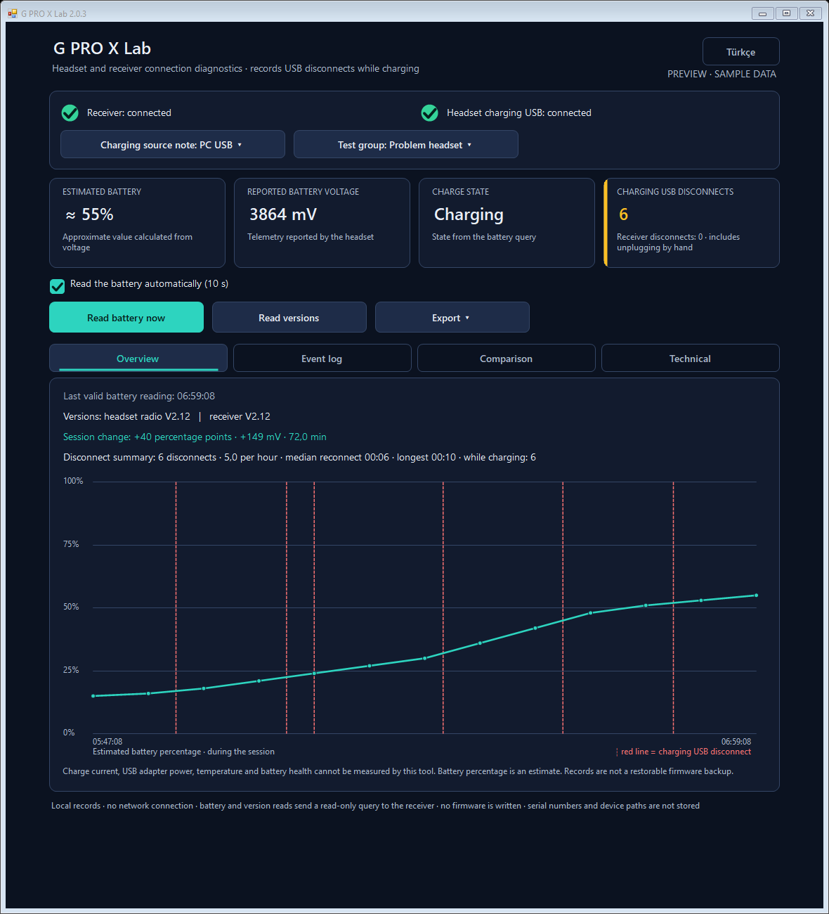

# PRO X Lab 2.0.2

Read-only connection diagnostics for first-generation Logitech PRO X Wireless headsets and their receivers. It records USB disconnects while the headset charges, shows the battery voltage the headset reports and an estimated percentage, and produces a support report that contains no personal identifiers.

[Türkçe kullanım](README.tr.md) · [Changelog](CHANGELOG.md) · [Security notes](SECURITY.md) · [Validation](docs/VALIDATION.md)



## Download

**[ProXLab-2.0.2.zip](downloads/ProXLab-2.0.2.zip)** (use the **Download raw file** button on the file page)

SHA-256: `9c9132d924592f8bcf8a153579c6b29e17e41485c2d37809a9a92a77e701c196`

Verify your download in PowerShell before opening it:

```powershell
Get-FileHash .\ProXLab-2.0.2.zip -Algorithm SHA256
```

The source code is in `src` so you can read it and build it yourself with `build.cmd` (Windows with .NET Framework 4.8, no extra tools) to run its `--self-test`. This is proprietary software, not open source: the source is for review and verification only, see [LICENSE](LICENSE).

## What it does

- **Records USB disconnects with exact times.** It follows the receiver (`046D:0ABA`) and the headset's charging USB interface (`046D:0ABB`) through Windows device notifications, plus a 5-second check as a fallback.
- **Marks every disconnect on the battery chart** and summarises them: how many, per hour, median and longest time to reconnect, how many happened while charging.
- **Reads the battery** (reported voltage, estimated percentage, charging state) from the receiver every 10 seconds. You can turn this off.
- **Compares a problem headset with a healthy one.** Choose a test group, connect only that headset's receiver, and the two sessions are shown side by side.
- **Exports** a support report (text), the full session (JSON) or the battery readings (CSV). None of them contains a serial number, device path, user name or machine name.

## What it sends to your devices

PRO X Lab never writes firmware, resets a device or disables one. It sends two kinds of read-only queries:

- **Battery query:** a 20-byte HID report to the receiver's vendor interface, every 10 seconds unless you switch automatic reading off, or when you press *Read battery now*.
- **Version query:** only when you press *Read versions*: a HID feature report to the receiver and to the headset's USB interface, to read their radio firmware version.

Both run in a short-lived helper process that is stopped if a driver call hangs. The program uses no network connection.

## Privacy

- The device serial number is **never read**. Device interface paths stay inside the helper process and are **never stored or exported**.
- Sessions are saved under `%LOCALAPPDATA%\ProXLab`. Exports and the support report mask your Windows user name, machine name and profile path. Review a report before you share it.

## Run

Requires Windows 10/11 and .NET Framework 4.8. Extract the ZIP and open `ProXLab.exe`. If the status line reports an access error, close any other program that uses the receiver and try again. Running PRO X Lab as administrator is not recommended: it is unsigned and runs from a folder that other software in your account can write to.

1. Connect the headset's receiver. Optionally connect the headset's USB cable to charge it.
2. In **Test group**, choose *Problem headset* or *Healthy headset*; use **Charging source note** to record how it is powered (PC USB, wall adapter, power bank).
3. Leave the program running while the headset charges. Disconnects appear on the chart and in the **Event log** tab.
4. Use **Export** to save the support report.

The top-right button switches between Turkish and English.

## Limits

- The percentage is an estimate interpolated from the reported voltage. Real capacity, charge current, temperature and battery health are **not measured**.
- USB disconnects include unplugging the cable by hand and bumping it.
- A reported disconnect does not by itself show the cause. Use the report as evidence when you talk to support or compare a warranty replacement.
- Verified on one PC with a first-generation PRO X Wireless headset. Other revisions are not verified. Disconnect capture was verified with synthetic device-change messages; the project owner also reported that disconnects were counted correctly in their own use. That is one person's report, not a recorded test (see [Validation](docs/VALIDATION.md)).
- The program is not digitally signed, so Windows SmartScreen or an antivirus may warn, and Windows 11 Smart App Control, where it is switched on, can block it. Do not switch off Windows security features for this tool.

## Changes from the earlier internal build (1.3.1)

No serial number or device path is read or saved; the non-working MCU query was removed; records live in `%LOCALAPPDATA%` instead of next to the program; disconnects are captured from Windows device events with exact times and drawn on the chart; there is a Turkish/English interface and a support report.

## License

This project is **proprietary and not open source** ([LICENSE](LICENSE)). The released application may be used only to diagnose your own headset and receiver. Logitech and PRO X are names of their owners and are used only to identify compatibility; this project is not affiliated with Logitech.
