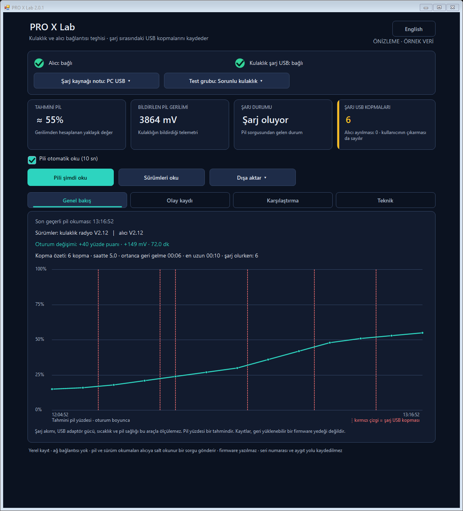

# PRO X Lab 2.0.1

İlk nesil Logitech PRO X Wireless kulaklıklar ve alıcıları için salt okunur bağlantı teşhis aracıdır. Kulaklık şarj olurken oluşan USB kopmalarını kaydeder, kulaklığın bildirdiği pil gerilimini ve tahmini pil yüzdesini gösterir, kişisel tanımlayıcı içermeyen bir destek raporu üretir.

[English](README.md) · [Değişiklik günlüğü](CHANGELOG.md) · [Güvenlik notları](SECURITY.md) · [Doğrulama](docs/VALIDATION.md)



## İndirme

**[ProXLab-2.0.1.zip](downloads/ProXLab-2.0.1.zip)** (dosya sayfasındaki **Download raw file** düğmesini kullanın)

SHA-256: `8014a45051ad50bdbd0887034ec91695a33118c420db95f14e7818b481cf0de6`

Açmadan önce indirdiğiniz dosyayı PowerShell'de doğrulayın:

```powershell
Get-FileHash .\ProXLab-2.0.1.zip -Algorithm SHA256
```

Bu depo yalnızca hazır indirmeyi ve belgelerini içerir; kaynak kodu içermez. Bu yazılım özel mülkiyetlidir, açık kaynak değildir: bkz. [LICENSE](LICENSE).

## Ne yapar?

- **USB kopmalarını tam saatiyle kaydeder.** Alıcıyı (`046D:0ABA`) ve kulaklığın şarj USB arayüzünü (`046D:0ABB`) Windows aygıt bildirimleriyle, yedek olarak 5 saniyelik bir denetimle de izler.
- **Her kopmayı pil grafiği üzerinde işaretler** ve özetler: kaç kopma olduğu, saatteki sayısı, geri gelme süresinin ortancası ve en uzunu, kaçının şarj olurken yaşandığı.
- **Pili okur.** Alıcıdan, kulaklığın bildirdiği gerilimi, tahmini yüzdeyi ve şarj durumunu 10 saniyede bir okur. Bunu kapatabilirsiniz.
- **Sorunlu kulaklığı sağlam bir kulaklıkla karşılaştırır.** Bir test grubu seçin, yalnızca o kulaklığın alıcısını takın; iki oturum yan yana gösterilir.
- **Dışa aktarır:** destek raporu (metin), tüm oturum (JSON) veya pil okumaları (CSV). Hiçbirinde seri numarası, aygıt yolu, kullanıcı adı veya makine adı bulunmaz.

## Aygıtlarınıza ne gönderir?

PRO X Lab hiçbir zaman firmware yazmaz, aygıtı sıfırlamaz veya devre dışı bırakmaz. İki tür salt okunur sorgu gönderir:

- **Pil sorgusu:** alıcının üretici arayüzüne 20 baytlık bir HID raporu. Otomatik okumayı kapatmadığınız sürece 10 saniyede bir, ayrıca *Pili şimdi oku* düğmesine bastığınızda gönderilir.
- **Sürüm sorgusu:** yalnızca *Sürümleri oku* düğmesine bastığınızda; alıcıya ve kulaklığın USB arayüzüne radyo firmware sürümünü okumak için bir HID özellik (feature) raporu.

İkisi de kısa ömürlü bir yardımcı işlemde çalışır; bir sürücü çağrısı takılırsa işlem durdurulur. Program ağ bağlantısı kullanmaz.

## Gizlilik

- Cihazın seri numarası **hiçbir zaman okunmaz**. Aygıt arayüz yolları yardımcı işlemin içinde kalır, **hiçbir yere kaydedilmez veya dışa aktarılmaz**.
- Oturumlar `%LOCALAPPDATA%\ProXLab` altına kaydedilir. Dışa aktarılan dosyalar ve destek raporu Windows kullanıcı adınızı, makine adınızı ve profil yolunuzu maskeler. Raporu paylaşmadan önce gözden geçirin.

## Çalıştırma

Windows 10/11 ve .NET Framework 4.8 gerekir. ZIP dosyasını çıkarın ve `ProXLab.exe` dosyasını açın. Durum satırı erişim hatası bildirirse alıcıyı kullanan diğer programları kapatıp yeniden deneyin. PRO X Lab'ın yönetici olarak çalıştırılması önerilmez: program imzasızdır ve hesabınızdaki diğer yazılımların yazabildiği bir klasörden çalışır.

1. Kulaklığın alıcısını takın. İsterseniz kulaklığın USB kablosunu da şarj için bağlayın.
2. **Test grubu** menüsünden *Sorunlu kulaklık* veya *Sağlam kulaklık* seçin; **Şarj kaynağı notu** ile nasıl beslendiğini (PC USB, priz adaptörü, powerbank) kaydedin.
3. Kulaklık şarj olurken programı açık bırakın. Kopmalar grafikte ve **Olay kaydı** sekmesinde görünür.
4. Destek raporunu kaydetmek için **Dışa aktar** menüsünü kullanın.

Sağ üstteki düğme Türkçe ile İngilizce arasında geçiş yapar.

## Sınırlar

- Yüzde, bildirilen gerilimden hesaplanan bir tahmindir. Gerçek kapasite, şarj akımı, sıcaklık ve pil sağlığı **ölçülmez**.
- USB kopmaları, kabloyu elle çıkarmayı ve kabloya çarpmayı da içerir.
- Bir kopma kaydı tek başına nedenini göstermez. Raporu, destek ekibiyle görüşürken veya garanti kapsamında değişim talep ederken kanıt olarak kullanın.
- Bir bilgisayarda, ilk nesil bir PRO X Wireless kulaklıkla doğrulanmıştır. Diğer revizyonlar doğrulanmamıştır. Kopma yakalama yapay aygıt değişikliği iletileriyle doğrulanmıştır; ayrıca proje sahibi kendi kullanımında kopmaların doğru sayıldığını bildirmiştir. Bu, kayıtlı bir test değil, tek kişinin bildirimidir ([Doğrulama](docs/VALIDATION.md)).
- Program dijital olarak imzalı değildir; Windows SmartScreen veya antivirüs yazılımı uyarı gösterebilir; Windows 11 Akıllı Uygulama Denetimi açıksa programı engelleyebilir. Bu araç için Windows güvenlik özelliklerini kapatmayın.

## Önceki iç sürümden (1.3.1) farklar

Seri numarası ve aygıt yolu okunmaz ve kaydedilmez; çalışmayan MCU sorgusu kaldırılmıştır; kayıtlar programın yanına değil `%LOCALAPPDATA%` altına yazılır; kopmalar Windows aygıt olaylarından tam saatiyle yakalanır ve grafikte gösterilir; Türkçe/İngilizce arayüz ve destek raporu vardır.

## Lisans

Bu proje **tescillidir ve açık kaynak değildir** ([LICENSE](LICENSE)). Yayımlanan uygulama yalnızca kendi kulaklığınızı ve alıcınızı teşhis etmek için kullanılabilir. Logitech ve PRO X, sahiplerinin adlarıdır ve yalnızca uyumluluğu belirtmek için kullanılır; bu proje Logitech ile bağlantılı değildir.
